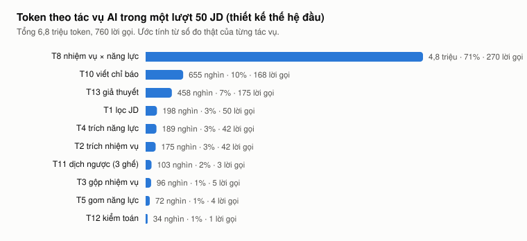
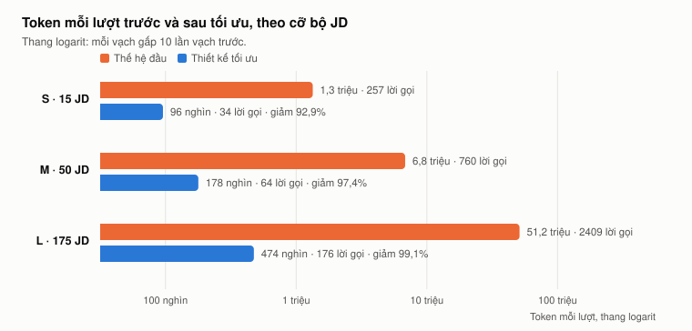
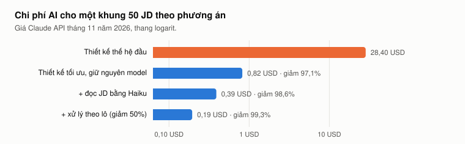
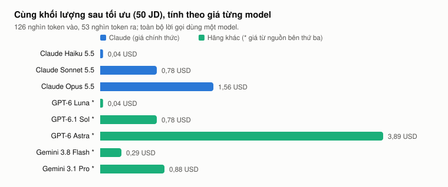

# Competence Lab · White paper kỹ thuật

**Dây chuyền sản xuất khung năng lực theo chuẩn SOP, có AI hỗ trợ và con người quyết định**

| | |
| --- | --- |
| Phiên bản | 1.0 · 17/11/2026 |
| Phạm vi | Mô tả hệ thống ở trạng thái mục tiêu (sau khi thực hiện đặc tả nâng cấp), kèm trạng thái hiện tại của từng bước so với chuẩn SOP |
| Chuẩn áp dụng | SOP-RA-CF-01 V1.1 (Sản xuất khung năng lực), SOP-RA-CF-02 V1.1 (Quản trị thay đổi và phát hành), Chuẩn kiến trúc dữ liệu năng lực v1.1, Sổ khung 1.1, Sổ tay căn cứ · Phụ lục bổ sung V1.1 |
| Tài liệu đi kèm | `docs/specs/competence-lab-upgrade-spec.md` (đặc tả nâng cấp, các gói U1–U16) |

**Cách đọc trạng thái.** Mỗi yêu cầu của chuẩn SOP được gắn một trong ba trạng thái so với mã nguồn ngày 17/11/2026:

- **ĐẠT**: mã nguồn đã làm đúng yêu cầu.
- **MỘT PHẦN**: có cơ chế tương ứng nhưng thiếu trường, khác ngưỡng hoặc khác công thức.
- **CHƯA**: chưa có.

Cột "Sau nâng cấp" trỏ tới gói trong đặc tả nâng cấp sẽ đưa yêu cầu đó về ĐẠT. White paper này không khẳng định điều gì là đã đạt nếu mã nguồn chưa làm.

**Số liệu.** Số "đo" lấy từ bảng `agent_call` của một lượt chạy thật 175 JD ngày 16/11/2026. Số "ước tính" lấy từ mô hình token mô tả ở mục 9.4. Hai loại luôn được ghi rõ.

---

## 1. Tóm tắt

Competence Lab biến một bộ mô tả công việc (JD) và bằng chứng hành vi thành khung năng lực của một vị trí, rồi ghi khung đó vào từ điển năng lực dùng chung. Hệ thống đi theo chín bước B0–B8 của chuẩn SOP. Mỗi bước kết thúc bằng một cổng tính từ dữ liệu; không cổng nào được đánh dấu đạt bằng tay.

Ba điểm thiết kế cốt lõi:

1. **Code tính, AI gợi ý, người quyết.** Mọi phép đếm, công thức, thống kê đồng thuận và cổng do code tính. AI đọc tài liệu, đề xuất mã và soạn nháp. Người độc lập tạo ra dữ liệu để qua cổng và ra quyết định cuối.
2. **Một cửa ghi vào lõi.** Dây chuyền sản xuất không ghi thẳng vào từ điển. Mọi thứ mới đi qua phiếu thay đổi và một bản phát hành có phiên bản.
3. **Truy được nguồn tới từng câu.** Mỗi nhiệm vụ, năng lực, chỉ báo trỏ về câu gốc trong bằng chứng. Mỗi kết quả AI được lưu kèm input, model và phiên bản prompt.

Trạng thái so với chuẩn SOP (395 yêu cầu được đối chiếu với mã nguồn):

| Phần chuẩn | Yêu cầu | Đạt | Một phần hoặc khác công thức | Chưa |
| --- | ---: | ---: | ---: | ---: |
| Quy trình 9 bước (SOP-01 §1–§7) | 91 | 14 | 30 | 47 |
| Hàng loạt, kiểm soát chất lượng, AI, thư viện (SOP-01 §8–§13, Sổ tay) | 70 | 8 | 27 | 35 |
| Sổ khung 1.1 (trang nhập, trang tự tính, cổng) | 74 | 3 | 39 | 32 |
| Chuẩn kiến trúc dữ liệu | 96 | 8 | 40 | 48 |
| Quản trị thay đổi và phát hành (SOP-02) | 64 | 6 | 23 | 35 |
| **Cộng** | **395** | **39 (10%)** | **159 (40%)** | **197 (50%)** |

Nói ngắn gọn: xương sống kỹ thuật (truy nguồn, cổng bằng code, một cửa ghi, ghim phiên bản, nhật ký bất biến) đã đúng chuẩn. Phần chưa đạt tập trung ở ba chỗ: không có người độc lập ở các cổng, ngưỡng và công thức khác SOP, và mô hình dữ liệu chưa theo Chuẩn kiến trúc.

Về AI: thiết kế hiện tại tiêu khoảng 6,8 triệu token cho một khung 50 JD và khoảng 51 triệu token cho 175 JD (ước tính; lượt chạy thật đã dừng ở 10,7 triệu token vì hết hạn mức). Thiết kế mục tiêu cần khoảng 151 nghìn và 424 nghìn token, giảm 97,8% và 99,2%. Ở mức tối thiểu 15 JD của chuẩn SOP, mức giảm là 94,3%.

---

## 2. Bài toán và chuẩn SOP

### 2.1 Bài toán

Một khung năng lực trả lời: ở vị trí này, cần những năng lực nào, ở bậc nào, biểu hiện bằng hành vi quan sát được nào, và căn cứ ở đâu. Làm bằng tay, một khung mất 11–27 ngày làm việc theo thời lượng tham khảo của chuẩn SOP (B0 0,5–1 ngày; B1 2–3; B2 0,5–1; B3 2–3; B4 1–5; B5 1–7; B6 3–5; B7 1–2; B8 0,5). Phần nặng nhất là đọc và mã hóa JD, viết chỉ báo, và tổ chức các vòng kiểm độc lập.

Hệ thống nhằm rút ngắn phần đọc, mã hóa, soạn nháp và tính toán, đồng thời giữ nguyên các vòng kiểm độc lập mà chuẩn SOP yêu cầu.

### 2.2 Những gì chuẩn SOP quy định

| Khái niệm | Nội dung |
| --- | --- |
| Chín bước | B0 khởi tạo · B1 thu thập và chấm JD · B2 neo phân loại nghề · B3 mã hóa và lập danh sách ứng viên · B4 thu hành vi thật · B5 chọn năng lực và bậc · B6 viết thẻ và kiểm tra · B7 thẩm định, phê duyệt · B8 hoàn tất, chuyển sang quản trị thay đổi |
| Cổng | G0–G8 cho chín bước; G11 (kiểm định theo tiêu chí hiệu suất) và G12 (công bằng giữa các nhóm) cho tầng cao nhất. Không qua cổng thì không sang bước sau |
| Hai chế độ | Chế độ 1: khung chuẩn thị trường, lưu ở lõi. Chế độ 2: may đo theo tổ chức, lưu ở cấu hình khách hàng |
| Ba mức chặt chẽ | A đầy đủ (BEI, khảo sát ≥ 10 người) · B tiết kiệm (phiếu sự kiện, khảo sát ≥ 5 người) · C bàn giấy (JD, nguồn chuẩn ngoài, thư viện) |
| Ba tầng phát hành | Nội bộ · Sản phẩm thị trường · Quyết định nhân sự. Tầng do máy tính từ mức và các cổng; không ai nâng tầng bằng chấp thuận |
| Ngưỡng mặc định | Cohen's kappa ≥ 0,61 · retranslation ≥ 70% · rwg ≥ 0,70 · tỷ lệ trùng với khung gốc ≥ 60% |
| Chuẩn đầu ra | Tập lõi 8–14 năng lực ở lớp I–III và tối đa 1 meta; mỗi năng lực có bậc yêu cầu hôm nay và sau 3 năm; chỉ báo viết ở bậc 1, 3, 5 (2–4 câu mỗi bậc); 3–5 kết quả chính và ma trận năng lực → kết quả |
| Bốn mức kiểm soát | KS1 tự động · KS2 người thứ hai · KS3 dữ liệu độc lập (mã hóa kép, khảo sát, retranslation, xếp lớp) · KS4 hội đồng có người ngoài |
| Vai trò | Mười vai trò và các cặp không kiêm nhiệm; người soạn (người hoặc AI) không được là người kiểm |
| AI | AI gợi ý và soạn nháp; con người quyết định ở mọi bước; AI không làm người mã hóa thứ hai, retranslation, xếp lớp, hội đồng |
| Sai lệch | Thiếu dữ liệu thì lập phiếu sai lệch; khung dừng ở tầng thấp hơn; B7 không được bỏ ở bất kỳ mức nào |

### 2.3 Bốn trục dữ liệu

Chuẩn kiến trúc dữ liệu chia lõi thành bốn trục, và hệ thống dùng đúng bốn trục đó:

| Trục | Chứa gì | Ví dụ |
| --- | --- | --- |
| **W** · công việc | Họ nghề, cấp bậc, vị trí chuẩn, nhiệm vụ, kết quả chính, bối cảnh ngành | Nhiệm vụ "Lập và theo dõi kế hoạch dự án" |
| **C** · năng lực | Phần tử năng lực, thang bậc, chỉ báo hành vi | Năng lực "Quản lý rủi ro dự án" và các chỉ báo bậc 1, 3, 5 |
| **R** · yêu cầu | Khung: đầu khung và các liên kết yêu cầu trỏ tới phần tử@phiên bản | Khung Project Manager, bậc yêu cầu 3 cho "Quản lý rủi ro dự án" |
| **V** · bằng chứng | JD, bản chụp nguồn, sự kiện, phiếu khảo sát, kết quả retranslation, biên bản | Câu số 7 của một JD đã chấm hạng P1 |

---

## 3. Kiến trúc

### 3.1 Thành phần

```
Trình duyệt ──► Web (Next.js) ──► PostgreSQL ◄── Worker ──► Claude CLI
                  │  màn hình,        │  phiên, lượt, block,        │  một tiến trình
                  │  API đọc/ghi      │  bằng chứng, từ điển,       │  cho mỗi lời gọi,
                  │  yêu cầu          │  kết quả AI, nhật ký        │  không dùng công cụ
                  └── không gọi AI    └── hàng đợi job              └── chỉ worker gọi
```

| Thành phần | Trách nhiệm | Mã nguồn |
| --- | --- | --- |
| Web | Màn hình, API. Chỉ đọc dữ liệu và xếp job vào hàng đợi. Không bao giờ gọi AI | `apps/web` |
| Worker | Lấy job, chạy block, gọi AI qua Claude CLI, ghi kết quả. Gửi tín hiệu sống theo chu kỳ | `apps/worker` |
| Dây chuyền | Logic của từng block: tính toán, cổng, vết diễn giải | `packages/pipeline` |
| Tác vụ AI | Định nghĩa từng tác vụ: prompt, schema đầu ra, kiểm tra bằng code | `packages/agents` |
| Sổ đăng ký | Một cửa ghi vào từ điển: kiểm nền, cấp mã, ghim phiên bản, tạo bản phát hành | `packages/registry` |
| Cơ sở dữ liệu | PostgreSQL: phiên, lượt, lần chạy block, bằng chứng, từ điển, kết quả AI, nhật ký sự kiện | `packages/db` |
| Hợp đồng dữ liệu | Kiểu dữ liệu dùng chung giữa web, worker và chế độ ví dụ | `packages/contract` |

### 3.2 Phiên, lượt, block

- **Phiên** là một vị trí cần xây khung. Ở trạng thái mục tiêu, phiên được mở bằng một charter (mục 5.1).
- **Lượt** là một lần chạy dây chuyền trên một bộ đầu vào đã khóa. Khi lượt bắt đầu, hệ thống chụp snapshot: bộ JD, bản phát hành nền của từ điển, chính sách ngưỡng, cấu hình model. Snapshot có hash; mọi block kiểm lại hash trước khi chạy.
- **Block** là một bước tính. Block nhận đầu ra của các block trước, tính, và sinh ra bản ghi, cổng, và một **vết diễn giải**: chuỗi các nhịp giải thích bằng lời thường cho biết block đã làm gì với dữ liệu thật.

Mỗi block có ba trạng thái quan trọng với người dùng: đang tính (kèm tiến độ theo từng tác vụ AI), chờ người xem và xác nhận đã hiểu, và đạt hoặc bị chặn theo cổng.

### 3.3 Cổng

Một cổng là một phép so sánh giữa số đo và ngưỡng, do code thực hiện. Cổng có bốn kết quả: đạt, chưa đạt, không áp dụng (theo mức chặt chẽ), và chưa đánh giá (thiếu dữ liệu, kèm lý do). Ở trạng thái mục tiêu, cổng còn ghi nó đạt **bằng dữ liệu** hay **bằng phiếu sai lệch**; phân biệt này quyết định tầng phát hành (mục 5.9).

### 3.4 Bất biến và kiểm toán

- Nhật ký sự kiện chỉ ghi thêm; mỗi sự kiện mang hash của sự kiện trước.
- Bản ghi của từ điển không bị sửa tại chỗ. Thay đổi tạo phiên bản mới; phiên bản cũ đọc lại được.
- Mỗi bản phát hành lưu danh sách đầy đủ các thành viên của nó, nên dựng lại được từ điển tại bất kỳ thời điểm nào.
- Chạy tự động có thể đưa dây chuyền đi từ B0 đến B8 nhưng dừng trước quyết định công bố. Quyết định đó luôn do người có quyền đưa ra, kèm lý do bắt buộc.

---

## 4. Mô hình dữ liệu

| Trục | Trạng thái mục tiêu | Hiện tại | Trạng thái |
| --- | --- | --- | --- |
| W | Họ nghề, cấp bậc (6 cấp, 2 nhánh), vị trí chuẩn có mã nghề Việt Nam và ISCO-08, nhiệm vụ thuộc họ nghề, kết quả chính, bối cảnh ngành (VSIC) | Nhiệm vụ có nhãn, trọng số, đoạn nguồn. Họ nghề và ngành là chữ tự do; mã nghề luôn là `UNVERIFIED`; không có kết quả chính | MỘT PHẦN |
| C | Phần tử có nhóm FND/LDR/PRO/MC, loại đặc điểm, định nghĩa 1–2 câu; chỉ báo có bậc, cực tính, cách đo, tầng bằng chứng, kết quả kiểm | Năng lực có tên, định nghĩa, nhãn đồng nghĩa; chỉ báo có câu, đoạn nguồn, kết quả sàng. Không có nhóm, bậc, cách đo | MỘT PHẦN |
| R | Đầu khung (loại khung, mức, tầng, kết quả cổng); liên kết yêu cầu (tập lõi, bậc hôm nay và 3 năm, lớp, nhãn, điểm khảo sát); liên kết tới kết quả chính | Khung liệt kê năng lực@phiên bản và chỉ báo@phiên bản; bậc luôn rỗng | MỘT PHẦN |
| V | Bản ghi bằng chứng có hạng nguồn, bản chụp, khử nhận dạng, đồng ý, hạn lưu, cấp bằng chứng B1–B4 | Đoạn JD và sự kiện có lớp bằng chứng (JD, thật) và trạng thái xác minh | MỘT PHẦN |
| Định danh | `uid` bất biến và `code` đọc được, theo quy tắc của Chuẩn | Mã cấp tuần tự hoặc theo hash | CHƯA |
| Phiên bản | MAJOR.MINOR.PATCH; mức tăng theo loại thay đổi | Số nguyên tăng dần; mọi thay đổi tăng như nhau | MỘT PHẦN |
| Nguồn gốc | Khối metadata trên mọi bản ghi: người hay AI tạo, input, phiên bản công cụ, người duyệt | Có ở mức lời gọi AI (`agent_call`, `agent_result`), chưa gắn vào bản ghi từ điển | MỘT PHẦN |
| Vòng đời | Nháp → Hiệu lực → Ngừng dùng; không xóa | Bất biến và không xóa: có. Trạng thái vòng đời: chưa | MỘT PHẦN |

Đối chiếu đầy đủ 96 yêu cầu của Chuẩn kiến trúc dữ liệu: 8 đạt, 40 một phần, 48 chưa. Gói nâng cấp: U11.

---

## 5. Quy trình chín bước theo chuẩn SOP

Mỗi bước dưới đây ghi: chuẩn SOP yêu cầu gì, hệ thống làm gì ở trạng thái mục tiêu, vai trò của AI và của người, cổng, và bảng trạng thái hiện tại.

### 5.1 B0 · Khởi tạo

**Chuẩn SOP yêu cầu.** Chốt vị trí chuẩn (họ nghề × cấp bậc), bối cảnh ngành, loại khung, quyết định khung phục vụ, chế độ, mức chặt chẽ, tiêu chí hiệu suất, và chỉ định vai trò. Cổng G0: người phê duyệt ký charter; các cặp không kiêm nhiệm đạt hoặc có phiếu sai lệch.

**Hệ thống làm gì.** Người vận hành lập charter trên màn hình. Code kiểm đủ trường, kiểm các cặp không kiêm nhiệm từ danh sách vai trò, chọn bộ ngưỡng theo (loại khung, mức), rồi khóa snapshot của lượt. Không có AI ở bước này.

| Yêu cầu | Hiện tại | Trạng thái | Sau nâng cấp |
| --- | --- | --- | --- |
| Vị trí, mục đích sử dụng | Có tên vị trí, mục đích; họ nghề và ngành dạng chữ tự do | MỘT PHẦN | U2.1, U11.1 |
| Khóa đầu vào bằng snapshot có hash | Có; mọi block kiểm lại hash | ĐẠT | Giữ |
| Chế độ, mức chặt chẽ, loại khung, tầng mục tiêu | Không có; một chính sách cố định | CHƯA | U2.2–U2.4 |
| Quyết định khung phục vụ, tiêu chí hiệu suất | Không có | CHƯA | U2.1 |
| Chỉ định vai trò, kiểm không kiêm nhiệm | Một tác nhân có mọi quyền | CHƯA | U1 |
| Cổng G0 | Cổng hiện tại chỉ kiểm đủ sáu trường và hash | MỘT PHẦN | U2.5 |

### 5.2 B1 · Thu thập và chấm JD

**Chuẩn SOP yêu cầu.** Mở từng tin, lưu bản chụp, ghi ngày đăng và ngày truy cập. Chấm năm tiêu chí 0–3: A cấp bậc, B lĩnh vực, C trọng tâm công việc, D độ mới, E độ tin cậy nguồn. Hạng nguồn tính bằng công thức:

```
L = A×3 + C×2 + D + E          (lăng kính cấp bậc, tối đa 21)
M = B×3 + C×2 + D + E          (lăng kính lĩnh vực, chỉ tính khi A ≥ 2)
Hạng = P1 nếu max(L, M) ≥ 18;  P2 nếu 13–17;  P3 nếu ≤ 12
```

Cổng G1: ≥ 15 JD đầy đủ đã lưu bản chụp, trong đó ≥ 5 JD hạng P1 (khung phái sinh: ≥ 10 JD của chính cấp bậc; biến thể ngành: ≥ 10 JD trong ngành). Trước khi đưa JD vào AI phải xóa tên, số điện thoại, email của người liên hệ.

**Hệ thống làm gì.** JD vào bằng ba đường: dán văn bản, tải tệp (tối đa 200 JD một bộ), hoặc quét một dataset tuyển dụng công khai đã tải về máy chủ. Code chuẩn hóa văn bản, cắt đoạn, phát hiện trùng theo hash và trùng gần đúng, che dữ liệu cá nhân, và tính điểm D, E từ ngày đăng và loại nguồn. AI đọc mỗi JD một lần và gợi ý: JD có đúng vị trí không, điểm A, B, C. Người phân tích xác nhận điểm. Code tính L, M, hạng và cổng G1.

**AI và người.** AI gợi ý từ khóa, lọc tiêu đề khi quét dataset, gợi ý điểm. Người mở nguồn, xác nhận điểm, quyết định JD nào được đếm.

| Yêu cầu | Hiện tại | Trạng thái | Sau nâng cấp |
| --- | --- | --- | --- |
| Nhập JD nhiều nguồn, tối đa 200 JD một bộ | Có: dán, tệp, dataset (hai dataset, 48 nghìn và 607 nghìn tin) | ĐẠT | Giữ |
| Loại JD trùng, JD lỗi, JD sai vị trí | Trùng theo hash toàn văn; AI phân loại đúng, sai, không chắc | ĐẠT | Thêm trùng gần đúng (U15) |
| Truy nguồn từng JD | Mọi JD hợp lệ phải có nguồn; cổng 100% | ĐẠT | Giữ |
| Bản chụp, ngày đăng, ngày truy cập, ngành | Chỉ có nhãn nguồn dạng chữ | CHƯA | U3.1 |
| Chấm A–E, tính L, M, hạng P1–P3 | Không có | CHƯA | U3.2 |
| Cổng G1: ≥ 15 JD, ≥ 5 P1 | Ngưỡng hiện tại là ≥ 1 JD hợp lệ | KHÁC CÔNG THỨC | U3.3 |
| Dùng lại JD đã chấm trong 36 tháng | Không có | CHƯA | U3.4 |
| Xóa dữ liệu cá nhân trước khi gửi AI | Chỉ gắn cờ email và số điện thoại, không chặn, không xóa | MỘT PHẦN | U3.5 |

### 5.3 B2 · Neo phân loại nghề

**Chuẩn SOP yêu cầu.** Ghi mã Danh mục nghề nghiệp Việt Nam và mã ISCO-08. Chọn 1–4 nghề gần nhất trong nguồn chuẩn ngoài có mô tả nhiệm vụ và điểm Importance; ghi lý do và phiên bản nguồn. Quy điểm 0–100 về thang 1–5:

```
Điểm 1–5 = 1 + điểm/100 × 4
```

Cổng G2: có mã nghề Việt Nam và ít nhất một nghề chuẩn ngoài kèm lý do.

**Hệ thống làm gì.** Code tra danh mục nghề và nguồn chuẩn ngoài theo tên vị trí và từ khóa của bộ JD, đưa ra danh sách rút gọn. AI gợi ý mã và nghề phù hợp nhất từ danh sách đó, kèm lý do. Người phân tích xác nhận trên nguồn gốc; bản chụp lưu vào V. Các nhiệm vụ, kiến thức, kỹ năng của nghề chuẩn ngoài trở thành câu yêu cầu cho B3 với trọng số nguồn bằng 3.

| Yêu cầu | Hiện tại | Trạng thái | Sau nâng cấp |
| --- | --- | --- | --- |
| Mã nghề Việt Nam, ISCO-08 | Trường mã nghề luôn mang giá trị `UNVERIFIED` | CHƯA | U4.1 |
| 1–4 nghề chuẩn ngoài có Importance, lý do, phiên bản | Không có | CHƯA | U4.2 |
| Mã ngành VSIC, ISIC cho khung theo ngành | Không có | CHƯA | U4.3 |
| Cổng G2 | Không có | CHƯA | U4.5 |

Đây là bước duy nhất của chuẩn SOP hoàn toàn chưa có trong hệ thống.

### 5.4 B3 · Mã hóa và lập danh sách ứng viên

**Chuẩn SOP yêu cầu.** Tách JD và nghề chuẩn ngoài thành câu yêu cầu. Mã hóa mỗi câu vào nhiệm vụ có sẵn trước, rồi vào phần tử năng lực có sẵn; câu không khớp mới tạo ứng viên mới, sau đó mới gom cụm. Không suy năng lực từ chức danh. Ma trận bằng chứng có trọng số theo hạng nguồn:

```
Trọng số bằng chứng của một ứng viên = Σ trọng số nguồn của các câu ủng hộ
   với  P1 = 3,  P2 = 2,  P3 = 1,  nguồn chuẩn ngoài = 3
```

Ở Mức A và B, người mã hóa thứ hai mã hóa độc lập ≥ 20% số câu; cổng G3 đạt khi Cohen's kappa ≥ 0,61. Ở Mức C, hội đồng kiểm lại ≥ 10% số câu ở B7.

**Hệ thống làm gì.** Bước này gồm hai block.

*Block nhiệm vụ.* Code so từng câu yêu cầu với nhãn và nhãn đồng nghĩa của nhiệm vụ đã có trong W. Câu không khớp được gom sơ bộ bằng độ giống văn bản. AI duyệt các cụm đề xuất và chỉ trả về phần cần sửa (gộp, tách, đổi câu đại diện). Code tính trọng số bằng chứng và lọc câu chung chung.

*Block ứng viên năng lực.* Tương tự cho năng lực: code tìm tối đa ba phần tử gần nhất trong từ điển cho mỗi cụm; AI đề xuất dùng lại, sửa, hay tạo mới; người mã hóa quyết định. Code tính tỷ lệ câu mã hóa được vào phần tử có sẵn (chỉ số bao phủ của thư viện).

Sau block này có một nhánh **giao nhanh**: lấy danh sách ứng viên làm bản thử cho mục đích phát triển, không ghi vào lõi.

**AI và người.** AI là người gợi ý mã, chỉ sau khi đã đo đồng thuận AI – người trên bộ neo. Người phân tích là người mã hóa 1. Người mã hóa 2 làm việc trên phiếu riêng, không thấy cột của người mã hóa 1 lẫn gợi ý của AI.

| Yêu cầu | Hiện tại | Trạng thái | Sau nâng cấp |
| --- | --- | --- | --- |
| Tách JD thành đơn vị có mã, lưu câu trích | Có: mỗi JD cắt thành đoạn có mã ổn định | ĐẠT | Giữ |
| Mỗi nhiệm vụ, ứng viên trỏ về đoạn nguồn | Có; code từ chối kết quả AI trỏ tới đoạn không tồn tại | ĐẠT | Giữ |
| Không suy năng lực từ chức danh | Prompt cấm; code bắt buộc có đoạn căn cứ | ĐẠT | Giữ |
| So với từ điển trước, đề xuất dùng lại, sửa, tạo mới | Có cho năng lực (trigram tên, từ khóa định nghĩa). Chưa có cho nhiệm vụ | MỘT PHẦN | U5.2 |
| Mã hóa vào mã có sẵn trước, gom cụm sau | Thứ tự ngược: trích, gom cụm, rồi mới so từ điển | MỘT PHẦN | U5.2 |
| Câu của nghề chuẩn ngoài cũng được mã hóa | Không có | CHƯA | U5.1 |
| Trọng số theo hạng nguồn 3, 2, 1, 3 | Trọng số = số JD nêu ÷ số JD hợp lệ | KHÁC CÔNG THỨC | U5.3 |
| Tỷ lệ bao phủ của thư viện | Không có | CHƯA | U5.4 |
| Mã hóa kép ≥ 20% câu, Cohen's kappa ≥ 0,61 (G3) | AI là người mã hóa duy nhất; không có kappa | CHƯA | U5.5 |
| Xếp lớp dự kiến, nhãn Hiện tại hoặc Mới nổi | Không có | CHƯA | U5.7 |
| Đo độ chính xác của việc trích so với đáp án | Cổng có sẵn nhưng luôn "chưa đánh giá, cần bộ đáp án độc lập" | MỘT PHẦN | U14.2 |

Ghi chú vận hành: ở bộ 175 JD, cách gom cụm hiện tại (chia lô theo thứ tự chữ cái) để lại 856 nhiệm vụ từ 1.066 nhiệm vụ thô và 554 nhóm năng lực. 721 trên 856 nhiệm vụ chỉ xuất hiện ở một JD. Thiết kế gom sơ bộ bằng code cộng cổng đuôi dài (mục 9.5) thay thế cách này.

### 5.5 B4 · Thu hành vi thật

**Chuẩn SOP yêu cầu.** Mức A: phỏng vấn sự kiện hành vi (BEI) với ≥ 6 người xuất sắc và ≥ 3 người trung bình, mỗi người ≥ 4 sự kiện; mã hóa kép ≥ 20% sự kiện với kappa ≥ 0,61. Mức B: phiếu sự kiện viết từ ≥ 3 người với ≥ 6 sự kiện, hoặc BEI ≥ 3 người. Mức C: đối chiếu với từ điển và thư viện; cổng G4 ghi "không áp dụng". Sự kiện phải được khử nhận dạng trước khi lưu và trước khi gửi AI.

**Hệ thống làm gì.** Người vận hành nhập sự kiện theo cấu trúc tình huống, hành động, kết quả, kèm nguồn và nhóm (xuất sắc hay trung bình). Code chặn sự kiện chưa khử nhận dạng và đếm số người, số sự kiện theo mức. AI gợi ý sự kiện nào ủng hộ ứng viên nào, trên bản đã khử. Chủ đề chỉ có ở nhóm xuất sắc trở thành ứng viên "tạo khác biệt"; chủ đề có ở mọi người là "ngưỡng"; chủ đề của nhóm trung bình thành "chỉ báo cần tránh".

| Yêu cầu | Hiện tại | Trạng thái | Sau nâng cấp |
| --- | --- | --- | --- |
| Nhập sự kiện có tình huống, hành động, kết quả, nguồn | Có | ĐẠT | Giữ |
| Sự kiện thật phải có nguồn | Có: cổng 100% sự kiện có nguồn | ĐẠT | Giữ |
| Phân biệt bằng chứng thật với giả thuyết | Có: giả thuyết do AI đề xuất được đánh dấu không phải bằng chứng | ĐẠT | Bỏ giả thuyết khỏi luồng mặc định (U6.6) |
| Cấu trúc BEI: mẫu tiêu chí, nhóm, số sự kiện mỗi người | Không có | CHƯA | U6.1 |
| Phiếu sự kiện viết (Mức B) | Không có | CHƯA | U6.2 |
| Cổng G4 theo mức | Không có sự kiện thì cổng ghi "không áp dụng" với mọi lượt | MỘT PHẦN | U6 |
| Khử nhận dạng, người thứ hai kiểm, bảng mã lưu tách | Sự kiện gửi AI nguyên văn | CHƯA | U6.4 |
| Phân loại ngưỡng, tạo khác biệt, cần tránh | Không có | CHƯA | U6.5 |

Về bản chất, block hiện tại tương đương Mức C của chuẩn SOP.

### 5.6 B5 · Chọn năng lực và bậc yêu cầu

**Chuẩn SOP yêu cầu.** Khảo sát ≥ 10 người (Mức A) hoặc ≥ 5 người (Mức B); mỗi ứng viên được chấm 1–5 về mức quan trọng, mức phân biệt người xuất sắc với trung bình, và cần ngay hay phát triển dần. Quy tắc giữ:

```
Mức A, B:  giữ khi  quan trọng ≥ 3,5  và  phân biệt ≥ 3,0  và  rwg ≥ 0,70
Mức C:     giữ khi  điểm thị trường chuẩn hóa ≥ 0,60  hoặc  Importance ≥ 3,5
```

Năm quyết định: giữ, giữ có điều kiện, gộp, loại, hoãn; quyết định nào cũng có lý do. Chốt tập lõi 8–14 năng lực ở lớp I–III và tối đa một meta. Đặt bậc yêu cầu hôm nay và sau 3 năm. Chủ họ nghề duyệt. Cổng G5: số năng lực trong giới hạn, đủ lý do, đủ cỡ mẫu, mọi năng lực FND và LDR có bậc hôm nay.

**Hệ thống làm gì.** Người trả lời khảo sát nhận đường dẫn tới phiếu riêng. Code tính trung bình, rwg, điểm thị trường chuẩn hóa từ ma trận bằng chứng của B3, và đề xuất quyết định theo quy tắc. AI lập ma trận nhiệm vụ × năng lực theo lô để phát hiện năng lực lõi không gắn nhiệm vụ nào và nhiệm vụ trọng số cao chưa có năng lực nào. Chủ họ nghề xem đề xuất, quyết định và ghi lý do.

| Yêu cầu | Hiện tại | Trạng thái | Sau nâng cấp |
| --- | --- | --- | --- |
| Liên hệ năng lực với nhiệm vụ | Có: AI chọn năng lực cho từng nhiệm vụ; code tính độ phủ có trọng số và phép thử "bỏ một" | ĐẠT (làm kiểm tra phụ) | Chuyển sang gọi theo lô (U15) |
| Tiêu chí chọn theo quy tắc giữ, loại | Chọn mọi năng lực có ít nhất một cạnh tới nhiệm vụ | KHÁC CÔNG THỨC | U7.2 |
| Khảo sát, cỡ mẫu, rwg | Không có | CHƯA | U7.1 |
| Tập lõi 8–14 và tối đa 1 meta | Không giới hạn; ở bộ 175 JD có 554 nhóm đi tiếp | CHƯA | U7.3 |
| Bậc yêu cầu hôm nay và sau 3 năm | Cơ chế ba phiếu AI có trong mã nhưng không bao giờ chạy vì thang bậc để rỗng; bậc luôn trống | CHƯA | U7.4 |
| Năm loại quyết định có lý do; chủ họ nghề duyệt | Không có | CHƯA | U7.2, U7.5 |
| Cổng G5 | Cổng hiện tại: độ phủ nhiệm vụ ≥ 0,8 | KHÁC CÔNG THỨC | U7 |

### 5.7 B6 · Viết thẻ năng lực và kiểm tra

**Chuẩn SOP yêu cầu.** Mỗi năng lực có thẻ đủ trường (nhóm, định nghĩa 1–2 câu, lớp, bậc, nhãn, cách đo, căn cứ). Chỉ báo viết ở bậc 1, 3, 5, mỗi bậc 2–4 câu, theo mẫu "Khi … nhằm …", mỗi chỉ báo có ít nhất một cách đo khác tự khai. Ba ràng buộc: R1 chỉ báo là hành vi của chính cá nhân; R2 mỗi năng lực lõi gắn ≥ 1 kết quả chính và mỗi kết quả có ≥ 2 năng lực; R3 mỗi chỉ báo thuộc đúng một phần tử, một bậc. Kiểm ba lớp:

1. Tự động (KS1) trước khi gửi người: cụm từ trùng giữa các phần tử, câu mô tả tính cách, câu hai hành vi, thiếu cách đo, bậc không tăng dần.
2. Retranslation (KS3): ≥ 3 người độc lập, không tham gia soạn, xếp từng chỉ báo đã xáo trộn vào năng lực và bậc; giữ chỉ báo đạt ≥ 70%.
3. Xếp lớp độc lập: cùng những người đó xếp từng năng lực vào lớp I, II, III hoặc Meta; Fleiss' kappa ≥ 0,61.

Cổng G6: mọi chỉ báo đạt ≥ 70%, Fleiss' kappa ≥ 0,61, R1 và R2 đạt.

**Hệ thống làm gì.** AI soạn nháp định nghĩa và chỉ báo theo bậc, chỉ từ câu yêu cầu và sự kiện đã có trong V. Code chạy kiểm tra KS1 trong khung và trên toàn ngân hàng chỉ báo; lỗi chặn chuyển bước. Người soạn biên tập; metadata ghi "AI soạn, người sửa" hoặc "AI soạn, người duyệt nguyên văn". Một lượt AI dịch ngược thử có thể chạy để bắt câu mơ hồ trước khi tốn công người; kết quả của nó không tính vào cổng. Sau đó phiếu retranslation và phiếu xếp lớp được gửi cho ≥ 3 người qua đường dẫn riêng: chỉ báo xáo thứ tự, mã bị che, đáp án giữ kín. Code tính tỷ lệ đúng theo từng chỉ báo (phiếu trắng nằm trong mẫu số) và Fleiss' kappa.

| Yêu cầu | Hiện tại | Trạng thái | Sau nâng cấp |
| --- | --- | --- | --- |
| AI soạn chỉ báo từ nguồn trong V, không từ hiểu biết chung | Có: chỉ báo phải trỏ về đoạn nguồn; code kiểm tham chiếu | ĐẠT | Giữ |
| Phiếu dịch ngược "mù": xáo thứ tự, che mã, lưu kết quả theo từng chỉ báo | Có cơ chế đầy đủ | ĐẠT (cơ chế) | Dùng lại cho người |
| Viết lại chỉ báo chưa đạt rồi kiểm lại | Có một vòng viết lại | ĐẠT | Giữ |
| Người làm retranslation: ≥ 3 người độc lập | Ba "ghế" AI (ba model) thay cho người | CHƯA | U8.5, U8.8 |
| Ngưỡng ≥ 70%, đúng cả năng lực và bậc | Ngưỡng ≥ 2/3, chỉ năng lực; phiếu trắng bị loại khỏi mẫu số; cổng không bắt buộc | KHÁC CÔNG THỨC | U8.5 |
| Chỉ báo ở bậc 1, 3, 5, mỗi bậc 2–4 câu | 1–3 chỉ báo mỗi năng lực, không theo bậc | CHƯA | U8.2 |
| Cách đo khác tự khai cho mỗi chỉ báo | Không có trường | CHƯA | U8.2 |
| Thẻ đủ trường (nhóm, lớp, nhãn, ngưỡng hay tạo khác biệt) | Chỉ có tên, định nghĩa, nhãn đồng nghĩa | CHƯA | U8.1 |
| Kiểm tra tự động KS1 | Chỉ kiểm tham chiếu và định dạng | MỘT PHẦN | U8.3 |
| Kết quả chính, ma trận năng lực → kết quả, R2 | Không có | CHƯA | U8.4 |
| Xếp lớp độc lập, Fleiss' kappa | Không có | CHƯA | U8.6 |
| Cổng G6 | Cổng hiện tại: còn ít nhất một năng lực qua sàng | KHÁC CÔNG THỨC | U8.10 |

### 5.8 B7 · Thẩm định và phê duyệt

**Chuẩn SOP yêu cầu.** Hội đồng ≥ 3 người, ≥ 1 người ngoài, không ai tham gia xây khung, chấm checklist 10 biến (phương pháp thu thập; loại nội dung; cách xây nội dung; độ chi tiết; liên kết mục tiêu; rà soát bởi chuyên gia; xếp ưu tiên; độ tin cậy; tiêu chí giữ, loại; tài liệu hóa). Mỗi biến: đạt, đạt có điều kiện, chưa đạt. Người phê duyệt khác trưởng nhóm khung. Cổng G7: cả 10 biến đạt, hoặc đạt có điều kiện kèm kế hoạch xử lý. Bước này không được bỏ ở bất kỳ mức nào. AI không ngồi hội đồng.

**Hệ thống làm gì.** Code dựng hồ sơ thẩm định: kết quả mọi cổng, số liệu đồng thuận, danh sách sai lệch, mẫu ngẫu nhiên ≥ 10% câu đã mã hóa (Mức C). AI chỉ kiểm định dạng, R1, R2 và câu chữ để hội đồng không tốn thời gian vào lỗi máy bắt được. Từng thành viên hội đồng chấm 10 biến trên phiếu riêng; code kiểm thành phần hội đồng và tổng hợp. Biên bản lưu vào V.

| Yêu cầu | Hiện tại | Trạng thái | Sau nâng cấp |
| --- | --- | --- | --- |
| Tổng hợp mọi cổng trước khi cho đi tiếp | Có: block nghiệm thu là phép AND của các cổng bắt buộc, kiểm lại độ phủ và hash | ĐẠT | Giữ làm KS1 |
| Quyết định của người kèm lý do | Có: chấp nhận hoặc từ chối, lý do bắt buộc | ĐẠT | Giữ |
| Hội đồng ≥ 3 người, ≥ 1 người ngoài, không ai xây khung | Không có; một người quyết | CHƯA | U9.1 |
| Checklist 10 biến | Không có | CHƯA | U9.1 |
| AI không thay hội đồng | AI kiểm toán nội dung trước công bố; phát hiện nghiêm trọng có thể dừng cả không gian làm việc | CHƯA đúng vai | U9.3 |
| Người phê duyệt khác trưởng nhóm khung | Không phân biệt người | CHƯA | U1.3 |
| Phiếu sai lệch với ba trạng thái | Không có | CHƯA | U9.4 |
| Kiểm lại ≥ 10% câu mã hóa (Mức C) | Không có | CHƯA | U9.2 |

### 5.9 B8 · Hoàn tất và chuyển sang quản trị thay đổi

**Chuẩn SOP yêu cầu.** Kiểm ghim phiên bản mọi phần tử và chỉ báo. Tự tính trạng thái, cấp bằng chứng, tầng phát hành, mục đích được phép. Sinh sáu bản xuất, không soạn hay sửa tay. Đặt hạn rà soát (12 tháng với họ nghề nặng công nghệ, dữ liệu, AI; 24 tháng với họ khác). Chuyển gói khung và phiếu thay đổi sang quy trình quản trị thay đổi. Cổng G8: có mã phiên bản, ngày rà soát, người phụ trách, không còn lỗi KS1.

Quy tắc tầng:

```
Quyết định nhân sự  ⇐  Mức A  và  điều kiện của tầng Sản phẩm  và  G11, G12 đạt
Sản phẩm thị trường ⇐  Mức ≥ B  và  G6, G7 đạt bằng dữ liệu
                        và không cổng nào trong G1, G3–G7 qua bằng phiếu sai lệch
Nội bộ              ⇐  các trường hợp còn lại
```

**Hệ thống làm gì.** Code dựng hồ sơ ứng viên: với mỗi nhiệm vụ, năng lực, chỉ báo, bằng chứng và khung, ghi rõ là tạo mới, sửa, hay dùng lại, kèm lý do và các khung bị ảnh hưởng. Code tính trạng thái và tầng theo quy tắc trên. Khi người có quyền chấp nhận, sổ đăng ký ghi trong một giao dịch: kiểm lại nền, cấp mã, ghim phiên bản, tạo bản phát hành và biên nhận có hash.

| Yêu cầu | Hiện tại | Trạng thái | Sau nâng cấp |
| --- | --- | --- | --- |
| Ghim phiên bản mọi phần tử, chỉ báo | Có: khung trỏ năng lực@phiên bản, chỉ báo@phiên bản; code kiểm tham chiếu | ĐẠT | Giữ |
| Không ghi thẳng vào lõi; một cửa ghi | Có: chỉ sổ đăng ký ghi, sau quyết định của người | ĐẠT | Giữ |
| Hồ sơ thay đổi ghi tạo mới, sửa, dùng lại và lý do | Có | ĐẠT | Tách thành phiếu theo loại (U12.1) |
| Bản phát hành bất biến, có biên nhận | Có | ĐẠT | Giữ |
| Mã phiên bản của khung | Có, dạng số nguyên | MỘT PHẦN | U11.6 |
| Tự tính trạng thái, cấp bằng chứng, tầng phát hành | Một phạm vi công bố cố định "nháp nội bộ" | CHƯA | U10.1, U10.2 |
| Hạn rà soát, người phụ trách | Không có | CHƯA | U10.4 |
| Sáu bản xuất sinh tự động | Có xuất gói dữ liệu của hệ thống; chưa có sáu bản theo chuẩn | MỘT PHẦN | U10.3 |
| Cổng G8 | Cổng hiện tại: có kết luận kiểm toán, không phát hiện mức dừng, tham chiếu đủ | MỘT PHẦN | U10.5 |
| G11, G12 | Không có | CHƯA | U10.2 |

### 5.10 Tổng hợp trạng thái chín bước

| Bước | Cổng | Trạng thái hiện tại | Khoảng trống chính | Gói |
| --- | --- | --- | --- | --- |
| B0 Khởi tạo | G0 | MỘT PHẦN | Charter, chế độ, mức, vai trò | U1, U2 |
| B1 Thu thập, chấm JD | G1 | MỘT PHẦN | Chấm A–E, hạng P1–P3, ngưỡng 15 và 5, xóa dữ liệu cá nhân | U3 |
| B2 Neo phân loại nghề | G2 | CHƯA | Toàn bộ | U4 |
| B3 Mã hóa, ứng viên | G3 | MỘT PHẦN | Mã hóa vào mã có sẵn trước, trọng số theo hạng, mã hóa kép và kappa | U5 |
| B4 Hành vi thật | G4 | MỘT PHẦN (tương đương Mức C) | BEI, phiếu sự kiện, khử nhận dạng | U6 |
| B5 Chọn năng lực, bậc | G5 | KHÁC CÔNG THỨC | Quy tắc giữ, loại, tập lõi 8–14, bậc, khảo sát và rwg | U7 |
| B6 Viết thẻ, kiểm tra | G6 | MỘT PHẦN | Chỉ báo theo bậc, retranslation do người, Fleiss' kappa, R2 | U8 |
| B7 Thẩm định, phê duyệt | G7 | CHƯA | Hội đồng, 10 biến, phiếu sai lệch | U9 |
| B8 Hoàn tất | G8 | MỘT PHẦN | Tầng phát hành, hạn rà soát, bản xuất | U10 |

---

## 6. Kiểm soát, vai trò, sai lệch

### 6.1 Bốn mức kiểm soát

| Mức | Chuẩn SOP | Trạng thái mục tiêu trong hệ thống | Hiện tại |
| --- | --- | --- | --- |
| KS1 tự động | Sai mã, thiếu trường, gãy tham chiếu, quên ghim phiên bản, R2, R3; lỗi thì chặn | Code: schema đóng, kiểm tham chiếu, kiểm chỉ báo, kiểm ghim phiên bản | MỘT PHẦN: có kiểm tham chiếu, hash, ghim phiên bản; chưa có kiểm chỉ báo, R2 |
| KS2 người thứ hai | Người thứ hai xem lại | Người biên tập chỉ báo; người kiểm bản khử nhận dạng | CHƯA |
| KS3 dữ liệu độc lập | Mã hóa kép, khảo sát, retranslation, xếp lớp | Phiếu riêng cho từng người; code tính kappa, rwg, tỷ lệ đúng, Fleiss' kappa | CHƯA: AI đang đứng ở vị trí này |
| KS4 hội đồng | Hội đồng có người ngoài | Phiếu 10 biến, kiểm thành phần | CHƯA |

### 6.2 Vai trò

Chuẩn SOP định mười vai trò và các cặp không kiêm nhiệm. Trạng thái mục tiêu: mỗi người đăng nhập bằng tài khoản riêng; vai trò gán theo khung; code từ chối hành động vi phạm cặp không kiêm nhiệm; AI được coi là một "người soạn" và chịu cùng ràng buộc. Hiện tại: một tác nhân duy nhất có đủ bốn quyền xem, vận hành, phê duyệt, quản trị sao lưu; web chỉ nghe ở địa chỉ nội bộ của máy. Trạng thái: CHƯA. Gói: U1.

### 6.3 Sai lệch

Thiếu dữ liệu cho một cổng không có nghĩa là bỏ cổng. Trạng thái mục tiêu: người vận hành lập phiếu sai lệch gắn với cổng, nêu lý do và rủi ro; người có thẩm quyền chấp thuận; cổng được ghi "đạt bằng phiếu sai lệch"; tầng phát hành tự hạ. Khung còn phiếu ở trạng thái Mở thì không phát hành được. Hiện tại: CHƯA. Gói: U9.4.

---

## 7. Quản trị thay đổi và phát hành

Chuẩn SOP tách việc **sản xuất** khung khỏi việc **ghi vào lõi và phát hành**. Phần sau gồm:

| Nội dung của chuẩn | Trạng thái mục tiêu | Hiện tại | Trạng thái |
| --- | --- | --- | --- |
| Một cửa ghi, có quyết định và lý do | Sổ đăng ký là đường ghi duy nhất | Có | ĐẠT |
| Đối tượng đã phát hành không bị sửa | Thay đổi là phiên bản mới | Có | ĐẠT |
| Dựng lại được từ điển tại mọi bản phát hành | Mỗi bản phát hành lưu đủ thành viên | Có | ĐẠT |
| Khung không tự nâng cấp khi phần tử đổi | Khung ghim phiên bản; nâng bằng phiếu | Có ghim phiên bản; chưa có phiếu nâng | MỘT PHẦN |
| Bảy loại thay đổi (cấu trúc, định nghĩa, hồ sơ vị trí, lớp biến động, bằng chứng, sửa lỗi, pháp lý và chuẩn ngoài), mỗi loại có người duyệt và mức phiên bản | Phiếu thay đổi là đối tượng riêng, có loại | Một hồ sơ ứng viên cho cả lượt, không phân loại | CHƯA |
| Phiên bản MAJOR.MINOR.PATCH | Theo loại thay đổi | Số nguyên | MỘT PHẦN |
| Nhịp phát hành năm, quý, theo sự kiện; ghi chú phát hành | Hàng chờ phiếu và bản phát hành đích | Mỗi quyết định chấp nhận tạo ngay một bản phát hành | CHƯA |
| Quay lui bằng một bản phát hành mới | Có màn hình, có kiểm thử | Có đường API; chưa có màn hình | MỘT PHẦN |
| Rà soát định kỳ theo họ nghề | Nhắc hạn, chạy lại B1 rút gọn | Chạy lại toàn bộ dây chuyền trên nền mới nhất | MỘT PHẦN |
| Chất lượng từ điển mỗi quý (năm chỉ số) | Báo cáo tự tính | Không có | CHƯA |
| Sổ tín hiệu, góp ý; nhập khung có sẵn | Có | Không có | CHƯA |
| Sản xuất hàng loạt: khung gốc, phái sinh, biến thể ngành; tỷ lệ trùng 60%; hội đồng chấm 1/5 lô | Có | Không có | CHƯA |

Đối chiếu đầy đủ 64 yêu cầu: 6 đạt, 23 một phần, 35 chưa. Gói: U12, U13.

---

## 8. AI trong hệ thống

### 8.1 Nguyên tắc

Chuẩn SOP quy định AI gợi ý và soạn nháp, con người quyết định ở mọi bước. Hệ thống cụ thể hóa thành năm quy tắc kỹ thuật:

1. **AI không có công cụ.** Mỗi lời gọi là một tiến trình Claude CLI riêng, tắt mọi công cụ, không đọc tệp, không truy cập mạng. AI chỉ thấy đúng phần dữ liệu được đưa vào.
2. **Đầu ra đóng.** Mỗi tác vụ có schema JSON nghiêm ngặt. Code kiểm mọi mã mà AI trả về phải tồn tại trong input; sai thì cho sửa một lần, sai tiếp thì từ chối.
3. **Lưu theo địa chỉ nội dung.** Khóa của một kết quả là hash của (tác vụ, model, phiên bản prompt, input). Cùng input thì không gọi lại; kết quả có thể kiểm lại bất kỳ lúc nào.
4. **Chỉ worker gọi AI, và gọi qua CLI.** Web không gọi AI. Worker gỡ mọi khóa API khỏi môi trường trước khi gọi.
5. **AI không qua cổng thay người.** Ở trạng thái mục tiêu, không kết quả AI nào được tính vào cổng KS3 hay KS4.

### 8.2 Phân vai theo chuẩn SOP và trạng thái

| Bước | AI được làm | AI không được làm | Hiện tại |
| --- | --- | --- | --- |
| B1 | Gợi ý từ khóa, tìm và trích JD | Đưa vào nguồn chưa ai mở | ĐẠT một phần: AI lọc và phân loại; chưa có bước người mở nguồn |
| B2 | Gợi ý mã nghề | – | CHƯA có bước |
| B3 | Gợi ý mã sau khi đo đồng thuận trên bộ neo | Làm người mã hóa thứ hai | Vi phạm tinh thần: AI là người mã hóa duy nhất, chưa đo đồng thuận |
| B4 | Gợi ý mã sự kiện trên bản đã khử nhận dạng | Nhận bản chưa khử | Chưa có bước khử |
| B5 | Tính thống kê, đề xuất | Chấm bậc thay người | Cơ chế ba phiếu AI cho bậc có trong mã nhưng không chạy |
| B6 | Soạn nháp chỉ báo từ V | Retranslation, xếp lớp | **Vi phạm:** ba ghế AI làm retranslation |
| B7, B8 | Kiểm định dạng, sinh bản xuất | Ngồi hội đồng | **Vi phạm:** AI kiểm toán nội dung thay cho thẩm định |

### 8.3 Dữ liệu và quyền riêng tư

Chuẩn SOP chia dữ liệu thành bốn lớp và đặt sáu quy tắc bắt buộc: khử nhận dạng trước khi gửi AI và có người thứ hai kiểm; đồng ý riêng và xem xét chuyển dữ liệu qua biên giới; chỉ dùng công cụ AI đã được tổ chức phê duyệt; hạn lưu; con người quyết định cuối cùng; kiểm phạm vi pháp lý với khách hàng ở EU.

| Quy tắc | Hiện tại | Trạng thái | Gói |
| --- | --- | --- | --- |
| Xóa tên, số điện thoại, email khỏi JD trước khi gửi AI | Gắn cờ, không xóa | MỘT PHẦN | U3.5 |
| Chỉ bản đã khử nhận dạng của sự kiện tới AI | Gửi nguyên văn | CHƯA | U6.4 |
| Chỉ dùng công cụ AI đã phê duyệt | Một ô xác nhận gửi dữ liệu cho mỗi phiên | MỘT PHẦN | U14.5 |
| Hạn lưu | Input của AI lưu nguyên văn vô thời hạn | CHƯA | U14.6 |
| Con người quyết định cuối cùng | Có | ĐẠT | Giữ |
| Ghi người tạo là người hay AI, input, phiên bản công cụ | Có ở mức lời gọi AI | MỘT PHẦN | U11.7 |
| Đo đồng thuận AI – người trên bộ neo trước khi dùng cho một lô | Không có | CHƯA | U14.2 |

---

## 9. Đánh giá các AI agent, token và chi phí

### 9.1 Danh mục agent hiện tại

Mười lăm tác vụ, ba model. "Effort" là mức suy luận đặt cho lời gọi.

| Mã | Việc | Bước SOP | Model · effort | Đơn vị gọi | Độ phức tạp |
| --- | --- | --- | --- | --- | --- |
| T1 | Lọc JD đúng vị trí | B1 | Haiku 5.5 · low | Mỗi JD | Thấp: phân loại ba nhãn |
| T2 | Trích nhiệm vụ từ một JD | B3 | Sonnet 5.5 · medium | Mỗi JD hợp lệ | Trung bình: trích có căn cứ, tối đa 12 mục |
| T3 | Gộp nhiệm vụ tương đương | B3 | Sonnet 5.5 · medium | Mỗi lô 100 mục | Cao: phân hoạch toàn bộ tập, output dài |
| T4 | Trích ứng viên năng lực từ một JD | B3 | Sonnet 5.5 · medium | Mỗi JD hợp lệ | Trung bình: phải suy từ yêu cầu ra năng lực, viết định nghĩa |
| T5 | Gom ứng viên cùng nội hàm | B3 | Sonnet 5.5 · medium | Mỗi lô 100 mục | Cao: phân hoạch theo nghĩa, đặt tên và định nghĩa chung |
| T6 | So với từ điển: dùng lại, sửa, tạo mới | B3 | Opus 5.5 · high | Mỗi nhóm có ứng viên gần giống | Cao: phán đoán ranh giới khái niệm, ảnh hưởng tới lõi |
| T7 | Sự kiện ủng hộ năng lực nào | B4 | Sonnet 5.5 · medium | Mỗi sự kiện | Trung bình |
| T13 | Đề xuất giả thuyết cho năng lực chưa có sự kiện | B4 | Sonnet 5.5 · medium | Mỗi nhóm năng lực | Thấp: sinh một câu; giá trị thấp |
| T8 | Nhiệm vụ cần năng lực nào | B5 | Sonnet 5.5 · medium | Mỗi nhiệm vụ, kèm toàn bộ danh sách năng lực | Trung bình về suy luận; rất nặng về input |
| T9 | Phiếu bậc yêu cầu | B5 | Haiku, Sonnet, Opus · medium | Ba ghế cho mỗi năng lực | Trung bình; hiện không chạy |
| T10 | Viết chỉ báo hành vi | B6 | Opus 5.5 · medium | Mỗi năng lực; viết lại cho câu chưa đạt | Cao: viết sáng tạo có ràng buộc, quyết định chất lượng khung |
| T11 | Dịch ngược chỉ báo | B6 | Haiku, Sonnet, Opus · medium | Ba ghế, mỗi ghế đọc mọi chỉ báo | Trung bình; theo chuẩn SOP đây là việc của người |
| T12 | Kiểm toán hồ sơ trước công bố | B7–B8 | Opus 5.5 · high | Một lần mỗi lượt | Cao: đọc toàn bộ hồ sơ, tìm mâu thuẫn |
| T14 | Chọn tiêu đề tin phù hợp khi quét dataset | B1 | Sonnet 5.5 · low | Mỗi lô tiêu đề | Thấp |
| T15 | Gợi ý từ khóa tìm kiếm | B1 | Haiku 5.5 · medium | Một lần mỗi lần quét | Thấp |

Nhận xét về cách chọn model:

- **Hợp lý:** T1 và T15 dùng Haiku; T6, T10, T12 dùng Opus, vì đây là ba chỗ một phán đoán sai đi thẳng vào từ điển.
- **Dùng model lớn hơn cần thiết:** T2, T4 (trích có cấu trúc), T8 và T13 (phân loại và sinh câu ngắn) dùng Sonnet; cùng số token, Haiku rẻ hơn 20 lần. Việc hạ model cần bộ neo để xác nhận chất lượng trước.
- **Sai vai theo chuẩn SOP:** T9, T11 và phần phán đoán nội dung của T12 đứng ở vị trí của người độc lập.

### 9.2 Số đo thật

Lượt Project Manager ngày 16/11/2026: 175 JD nhập, 131 JD hợp lệ, chạy tự động từ B0, dừng giữa block nối nhiệm vụ – năng lực vì hết hạn mức 5 giờ của gói Claude.

| Tác vụ | Lời gọi | Token vào mỗi lời gọi | Token ra mỗi lời gọi | USD mỗi lời gọi | Cộng USD | Thời gian mỗi lời gọi |
| --- | ---: | ---: | ---: | ---: | ---: | ---: |
| T1 | 175 | 2.305 | 452 | 0,0007 | 0,12 | 4 giây |
| T2 | 131 | 2.280 | 684 | 0,0161 | 2,11 | 9 giây |
| T3 | 17 | 10.207 | 7.813 | 0,1191 | 2,02 | 38 giây |
| T4 | 189 | 1.669 | 1.049 | 0,0174 | 3,28 | 12 giây |
| T5 | 52 | 10.034 | 7.197 | 0,1124 | 5,85 | 35 giây |
| T13 | 566 | 975 | 440 | 0,0084 | 4,77 | 7 giây |
| T8 (110 trên 856) | 110 | 50.353 | 202 | 0,2035 | 22,39 | 11 giây |
| **Cộng** | **1.240** | | | | **40,54** | |

Tổng: 7,80 triệu token ghi bộ nhớ đệm, 1,76 triệu token đọc bộ nhớ đệm, 1,15 triệu token ra; khoảng 10,7 triệu token. Cột USD là số Claude CLI báo, tức quy đổi theo giá API; gói thuê bao không tính tiền theo lời gọi mà giới hạn theo hạn mức. Sau khi hết hạn mức, 747 lời gọi còn lại thất bại ngay.

Chưa có số đo cho T6, T7, T9, T10, T11, T12 trên bộ lớn.

### 9.3 Token đi đâu



Một tác vụ chiếm 71% token: T8. Mỗi lời gọi T8 gửi lại toàn bộ danh sách năng lực để hỏi về một nhiệm vụ. Số lời gọi bằng số nhiệm vụ, kích thước mỗi lời gọi tỷ lệ với số năng lực, nên tổng token tăng theo tích của hai con số. Ở bộ 175 JD tích đó là 856 × 554 và T8 chiếm 88%.

Các nguyên nhân còn lại, theo thứ tự ảnh hưởng: không cắt bớt ứng viên trước các bước đắt (chuẩn SOP chỉ giữ 8–14 năng lực lõi, hệ thống mang cả trăm nhóm đi tiếp); một JD bị đọc ba lần; giả thuyết sinh cho mọi nhóm; gom cụm bằng cách bắt AI viết lại toàn bộ phân hoạch; mã định danh dài; và CLI ghi toàn bộ prompt vào bộ nhớ đệm một giờ (gấp đôi giá input khi quy đổi) mà không lời gọi nào đọc lại.

### 9.4 Mô hình ước tính

Mô hình nhân số lời gọi của từng tác vụ với token mỗi lời gọi. Với thiết kế hiện tại, token mỗi lời gọi lấy từ số đo ở mục 9.2; T8 nội suy theo số nhóm năng lực (91 token mỗi nhóm cộng 600); T10, T11, T12 ước tính từ kích thước prompt. Kiểm chéo: tại điểm lượt 175 JD dừng lại, mô hình cho 35,6 USD so với số đo 40,54 USD (lệch 12%).

Ba kịch bản:

| Kịch bản | JD nhập | JD hợp lệ | Nhiệm vụ sau gộp | Nhóm năng lực | Ghi chú |
| --- | ---: | ---: | ---: | ---: | --- |
| S | 15 | 14 | 85 | 62 | Mức tối thiểu của cổng G1; ước tính |
| M | 50 | 42 | 270 | 175 | Ước tính |
| L | 175 | 131 | 856 | 554 | Số đo của lượt thật |

### 9.5 Thiết kế mục tiêu

Nguyên tắc: code làm mọi việc đếm, so chuỗi, gom sơ bộ và cắt đuôi; AI đọc mỗi tài liệu một lần và chỉ phán đoán trên danh sách đã rút gọn.

| Agent mới | Thay cho | Đơn vị gọi | Model | Độ phức tạp | Vai theo chuẩn SOP |
| --- | --- | --- | --- | --- | --- |
| E1 Đọc JD một lần | T1, T2, T4 | Mỗi JD không trùng | Haiku 5.5 sau khi qua bộ neo; Sonnet 5.5 trước đó | Trung bình | Gợi ý điểm JD, câu yêu cầu, mã (B1, B3) |
| E2 Gợi ý neo nghề | Mới | 1 mỗi khung | Sonnet 5.5 | Thấp | Gợi ý, người xác nhận (B2) |
| E3 Duyệt cụm nhiệm vụ | T3 | 1 mỗi 400 mục | Sonnet 5.5 | Trung bình | Gợi ý mã (B3) |
| E4 Duyệt cụm năng lực, so thư viện | T5, T6 | 1 mỗi 400 mục | Sonnet 5.5 | Cao | Gợi ý mã (B3) |
| E5 Ma trận nhiệm vụ × năng lực | T8 | 1 mỗi 25 nhiệm vụ | Sonnet 5.5 | Trung bình | Đề xuất (B5) |
| E6 Soạn chỉ báo theo bậc | T10 | 1 mỗi 3 năng lực lõi | Sonnet 5.5 soạn; Opus 5.5 cho phần bị trả lại | Cao | Soạn nháp (B6) |
| E7 Soát trước khi gửi người | T11 | 1 mỗi khung, tùy chọn | Sonnet 5.5 | Trung bình | Không tính vào cổng |
| E8 Kiểm định dạng hồ sơ | T12 | 1 mỗi khung | Opus 5.5 · medium | Trung bình | KS1, không thay hội đồng (B7) |
| Bỏ | T9, T13 | – | – | – | Bậc do người quyết; giả thuyết không có trong chuẩn SOP |
| Giữ | T14, T15 | Như cũ | Sonnet, Haiku | Thấp | Tìm JD (B1) |

Các việc chuyển từ AI sang code: phát hiện JD trùng gần đúng; che dữ liệu cá nhân; rút gọn mã định danh trong mỗi lời gọi; tra thư viện trước; gom sơ bộ bằng độ giống văn bản; cổng đuôi dài theo trọng số bằng chứng; lọc câu chung chung. Chi tiết ở đặc tả nâng cấp, mục 5.

### 9.6 Token trước và sau



| Kịch bản | Hiện tại | Mục tiêu | Giảm token | Giảm số lời gọi |
| --- | --- | --- | ---: | ---: |
| S · 15 JD | 257 lời gọi · 1,34 triệu token | 28 lời gọi · 76 nghìn token | 94,3% | 89% |
| M · 50 JD | 760 lời gọi · 6,82 triệu token | 58 lời gọi · 151 nghìn token | 97,8% | 92% |
| L · 175 JD | 2.409 lời gọi · 51,2 triệu token | 168 lời gọi · 424 nghìn token | 99,2% | 93% |

Tất cả là ước tính. Cột "Hiện tại" dựa trên số đo từng tác vụ; cột "Mục tiêu" dựa trên kích thước prompt thiết kế và chưa được đo. Ở kịch bản S, mức giảm vẫn trên 90% nếu thiết kế mục tiêu tốn gấp 1,7 lần ước tính; ở M và L biên này là hơn 4 lần.

Thiết kế mục tiêu tăng gần tuyến tính theo số JD: bước đọc JD chiếm 45% token ở S và 81% ở L, còn các bước sau gần như cố định vì tập lõi bị giới hạn ở 8–14 năng lực.

### 9.7 Chi phí theo phương án (Claude)



| Phương án | S · 15 JD | M · 50 JD | L · 175 JD |
| --- | ---: | ---: | ---: |
| Hiện tại, qua CLI, quy đổi theo giá API | 5,87 USD | 28,40 USD | 207,86 USD |
| Hiện tại, nếu gọi thẳng API (không ghi đệm 1 giờ, không khung CLI), toàn bộ bằng Sonnet 5.5 | 3,56 USD | 16,09 USD | 110,08 USD |
| Mục tiêu, giữ nguyên model | 0,38 USD | 0,70 USD | 1,86 USD |
| Mục tiêu, E1 dùng Haiku 5.5 | 0,23 USD | 0,27 USD | 0,39 USD |
| Mục tiêu, E1 dùng Haiku 5.5, qua Batch API | 0,12 USD | 0,14 USD | 0,20 USD |

Ba điều rút ra:

1. Đổi đường truyền mà không đổi cấu trúc chỉ giảm được 39–47%. Phần lớn mức giảm đến từ cấu trúc lời gọi.
2. Sau khi đổi cấu trúc, chi phí theo API cho một khung dưới 2 USD ở mọi cỡ bộ JD. Lúc đó chi phí AI không còn là ràng buộc; ràng buộc là thời gian của người ở các cổng KS3, KS4.
3. Với gói thuê bao qua CLI, con số cần nhìn là token so với hạn mức: lượt 175 JD hiện tại cần khoảng năm lần hạn mức 5 giờ đã quan sát được (10,7 triệu token thì chạm trần); thiết kế mục tiêu dùng khoảng 4% hạn mức đó.

Bảng giá Claude API dùng để tính (USD mỗi triệu token, đọc từ trang giá chính thức ngày 17/11/2026):

| Model | Vào | Ghi đệm 5 phút | Ghi đệm 1 giờ | Đọc đệm | Ra | Batch (vào / ra) |
| --- | ---: | ---: | ---: | ---: | ---: | ---: |
| Claude Haiku 5.5 | 0,10 | 0,125 | 0,20 | 0,01 | 0,50 | 0,05 / 0,25 |
| Claude Sonnet 5.5 | 2,00 | 2,50 | 4,00 | 0,10 | 10,00 | 1,00 / 5,00 |
| Claude Opus 5.5 | 4,00 | 5,00 | 8,00 | 0,20 | 20,00 | 2,00 / 10,00 |

### 9.8 So sánh với API của hãng khác

Cùng một khối lượng token, tính theo giá công bố của từng model. Giả định đơn giản: toàn bộ lời gọi dùng một model, không tính bộ nhớ đệm và không tính giảm giá theo lô.



| Model | Giá vào / ra (USD mỗi triệu token) | Hiện tại · M (5,62 triệu vào, 0,48 triệu ra) | Mục tiêu · M (103 nghìn vào, 48 nghìn ra) |
| --- | --- | ---: | ---: |
| Claude Haiku 5.5 | 0,10 / 0,50 | 0,80 USD | 0,03 USD |
| Claude Sonnet 5.5 | 2 / 10 | 16,09 USD | 0,69 USD |
| Claude Opus 5.5 | 4 / 20 | 32,18 USD | 1,38 USD |
| GPT-6 Luna * | 0,10 / 0,50 | 0,80 USD | 0,03 USD |
| GPT-6.1 Sol * | 2 / 10 | 16,09 USD | 0,69 USD |
| GPT-6 Astra * | 10 / 50 | 80,46 USD | 3,45 USD |
| Gemini 3.8 Flash * | 0,75 / 3,75 | 6,03 USD | 0,26 USD |
| Gemini 3.1 Pro * | 2 / 12 | 17,06 USD | 0,79 USD |

\* **Giá của hãng khác lấy từ các trang tổng hợp của bên thứ ba, không phải từ trang giá chính thức, và các nguồn có chỗ không thống nhất. Chỉ dùng để tham khảo; cần xác nhận lại trước khi ra quyết định.** Giá Gemini 3.8 Flash là giá giới thiệu, theo nguồn sẽ tăng gấp đôi từ 01/01/2027.

Cách đọc bảng:

- Số token giữa các hãng không bằng nhau cho cùng một văn bản vì mỗi hãng tách token khác nhau. Tiếng Việt có dấu đặc biệt nhạy với điều này (ở Claude đo được khoảng 1,8 ký tự mỗi token cho JSON tiếng Việt). Sai số do tách token có thể tới vài chục phần trăm.
- Ở cùng một bậc model, giá công bố của các hãng gần như ngang nhau. Chênh lệch giữa các hãng nhỏ hơn nhiều so với chênh lệch giữa các bậc model (20 lần giữa Haiku và Sonnet) và nhỏ hơn rất nhiều so với mức giảm nhờ đổi cấu trúc (45 lần ở kịch bản M).
- Bảng không nói gì về chất lượng. Chưa có phép đo nào của hệ thống này trên model ngoài Claude. Chuẩn SOP yêu cầu đo đồng thuận AI – người trên bộ neo cho từng công cụ trước khi dùng, và chỉ dùng công cụ đã được tổ chức phê duyệt; đổi hãng là đổi công cụ và phải qua cả hai bước đó.
- Hệ thống hiện chỉ gọi Claude qua CLI. Dùng API của bất kỳ hãng nào cũng là một thay đổi kiến trúc cần quyết định riêng (đặc tả nâng cấp, câu hỏi Q5).

### 9.9 Đánh giá chung

| Tiêu chí | Hiện tại | Sau nâng cấp |
| --- | --- | --- |
| Đúng vai theo chuẩn SOP | AI đứng ở ba vị trí của người độc lập (retranslation, bậc, thẩm định nội dung) | AI chỉ gợi ý và soạn nháp; kết quả soát trước không tính vào cổng |
| Kiểm soát đầu ra | Tốt: schema đóng, kiểm tham chiếu bằng code, lưu theo địa chỉ nội dung | Giữ |
| Đo chất lượng | Chưa có bộ neo; chưa có số đồng thuận AI – người | Bộ neo là điều kiện để bật từng agent |
| Hiệu quả token | Kém ở quy mô lớn: tăng theo tích số nhiệm vụ × số năng lực | Gần tuyến tính theo số JD; giảm 94–99% |
| Chọn model | Hợp lý ở hai đầu (Haiku cho lọc, Opus cho phán đoán vào lõi); Sonnet dùng thừa cho trích và phân loại | Định tuyến theo kết quả bộ neo |
| Chốt chặn | Giới hạn số lời gọi mỗi lượt; không dừng khi hết hạn mức | Ngân sách token, ước tính trước khi chạy, cầu dao hạn mức |
| Quyền riêng tư | Chỉ gắn cờ dữ liệu cá nhân; lưu input vô thời hạn | Che trước khi gửi; sổ đăng ký công cụ AI; hạn lưu |

---

## 10. Giới hạn và rủi ro

1. **Con số của thiết kế mục tiêu là ước tính.** Chúng cần được đo trên một bộ 50 JD chuẩn trước khi dùng để cam kết. Con số của thiết kế hiện tại ở các bước B6–B8 cũng là ước tính vì lượt chạy thật dừng ở B5.
2. **Chất lượng sau tối ưu chưa được đo.** Gộp ba tác vụ đọc JD vào một lời gọi, hạ model, và cắt đuôi dài đều có thể làm mất thông tin. Bộ neo do người gắn nhãn là điều kiện tiên quyết.
3. **Con người là nút thắt mới.** Khi các cổng KS3, KS4 do người thật đảm nhiệm, một khung Mức B cần ít nhất ba người retranslation, năm người khảo sát và ba thành viên hội đồng. Thời gian chu kỳ sẽ do lịch của những người này quyết định, không do AI.
4. **Nguồn JD.** Các dataset công khai có giấy phép khác nhau (một dataset đang dùng mang giấy phép phi thương mại) và thường thiếu ngày đăng, nên điểm độ mới thấp và khó đạt đủ năm JD hạng P1 chỉ từ dataset.
5. **Giá của hãng khác** lấy từ nguồn bên thứ ba và có thể đã lỗi thời.
6. **Một số hình minh họa của chuẩn SOP** (phép thử phân lớp, mẫu câu chỉ báo, lưu đồ tính tầng) là ảnh và không đọc được bằng máy; các quy tắc tương ứng trong tài liệu này lấy từ phần chữ.

---

## Phụ lục A · Thuật ngữ

| Thuật ngữ | Nghĩa |
| --- | --- |
| JD | Mô tả công việc trong tin tuyển dụng |
| BEI | Phỏng vấn sự kiện hành vi |
| SME | Chuyên gia nội dung |
| Retranslation | Người độc lập xếp lại từng chỉ báo vào năng lực và bậc mà không biết đáp án |
| Cohen's kappa, Fleiss' kappa | Hệ số đồng thuận giữa hai người, và giữa nhiều người, đã trừ phần trùng ngẫu nhiên |
| rwg | Chỉ số đồng thuận trong nhóm người chấm cùng một đối tượng |
| Importance | Điểm mức quan trọng của một nội dung công việc trong nguồn chuẩn ngoài |
| FND, LDR, PRO, MC | Bốn nhóm năng lực theo Chuẩn kiến trúc dữ liệu |
| Lớp I, II, III, Meta | Lớp của năng lực theo đối tượng chính của hành vi: cá nhân và chuyên môn; kết nối con người; tổ chức và hệ thống; meta |
| P1, P2, P3 | Hạng nguồn của JD sau khi chấm |
| KS1–KS4 | Bốn mức kiểm soát |
| Token | Đơn vị văn bản mà model tính phí và giới hạn |
| Bộ neo | Bộ mẫu do người gắn nhãn, dùng để đo đồng thuận AI – người |

## Phụ lục B · Nguồn số liệu

- **Chuẩn SOP:** năm tài liệu nêu ở đầu white paper, bản ngày 14/11/2026.
- **Mã nguồn:** nhánh `toantran.mei/feat-built-in`, đọc ngày 17/11/2026. Các tệp chính: `packages/pipeline/src/blocks-a.ts`, `blocks-b.ts`, `types.ts`, `sessions.ts`, `auth.ts`; `packages/agents/src/tasks.ts`, `config.ts`, `run-task.ts`, `runner.ts`; `packages/registry/src/commit.ts`; `packages/db/src/schema.ts`.
- **Số đo token:** bảng `agent_call` của lượt `run_4e348a3e5ed44beeaff5`, ngày 16/11/2026.
- **Giá Claude API:** trang giá chính thức của Claude API, đọc ngày 17/11/2026.
- **Giá của hãng khác (tham khảo):** các trang tổng hợp benchlm.ai, morphllm.com, cloudzero.com, developer.puter.com, đối chiếu với openai.com/api/pricing và ai.google.dev/pricing; đọc ngày 17/11/2026.
- **Bảng đối chiếu từng yêu cầu** (395 dòng, kèm vị trí trong mã nguồn) là tài liệu làm việc của đợt rà soát này; phần tổng hợp nằm ở đặc tả nâng cấp.
